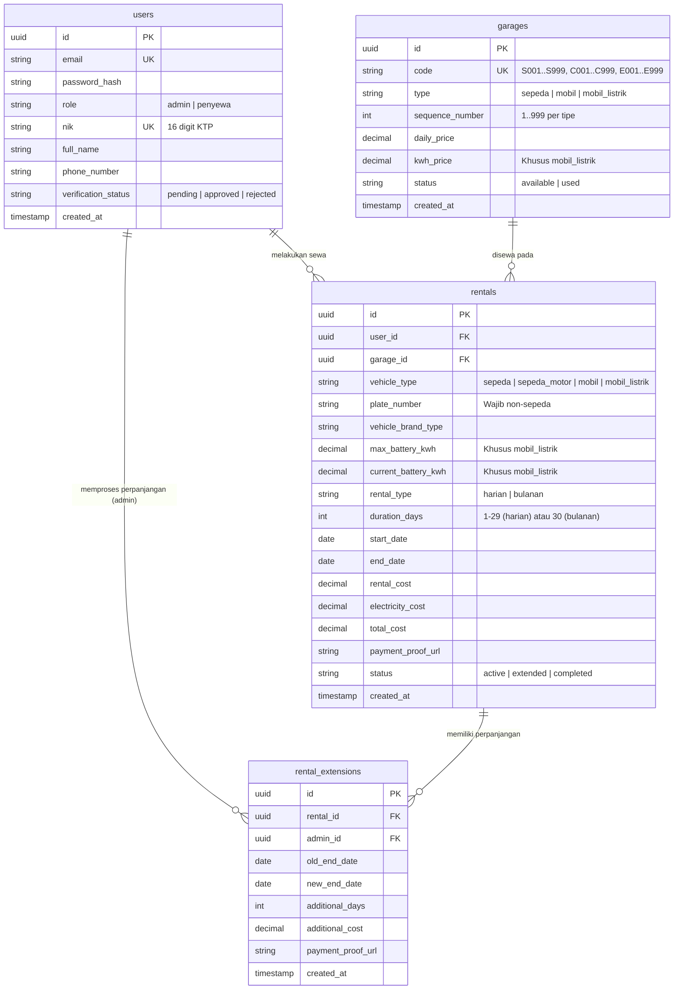

# GARENT (Garage Rental) — Sistem Penyewaan Garasi Kendaraan & Pengisian EV

> **Nama Proyek:** **GARENT** (*Garage Rental*)  
> **Skema Uji Kompetensi:** LSP Pemrogram (Sistem Berbasis Web & Object-Oriented Programming)  
> **Teknologi Utama:** Next.js 15 (App Router, TypeScript Strict), Tailwind CSS, Supabase (PostgreSQL + Storage `payment-proofs`), Prisma ORM, Vitest.

---

## 📌 Ringkasan Proyek

**GARENT** (*Garage Rental*) adalah platform persewaan garasi kendaraan multi-tipe (Sepeda/Sepeda Motor, Mobil Bensin, Mobil Listrik/EV) yang dirancang dengan standar arsitektur perangkat lunak industri:
1. **Pemrograman Berorientasi Objek (OOP) & Clean Architecture:** Seluruh logika bisnis dipisahkan ke dalam *Service Classes* terdedikasi di folder `src/services/` (`GarageService`, `RentalService`, `AuthService`) lengkap dengan dokumentasi JSDoc/TSDoc.
2. **Kesesuaian Basis Data Relasional:** File `supabase/schema.sql` memuat seluruh struktur DDL tabel relasional (`users`, `garages`, `rentals`, `rental_extensions`), seeder default admin, dan konfigurasi bucket Supabase Storage `payment-proofs`.
3. **Kalkulasi Bisnis Presisi:** Mendukung sewa harian (1–29 hari), sewa bulanan promo 25&times; tarif harian, kalkulasi pengisian daya listrik penuh (*mandatory full charge*) untuk mobil listrik di garasi EV, dan perpanjangan sewa otomatis.
4. **Unit Testing 100%:** Suite pengujian unit komprehensif menggunakan Vitest mencakup 62 skenario pengujian dengan hasil 100% lulus.

---

## 🗄️ Struktur Basis Data Supabase (`supabase/schema.sql`)

Struktur tabel relasional yang digunakan dalam sistem GARENT:



### 🚀 Cara Menjalankan SQL di Supabase:
1. Buka dashboard proyek Supabase Anda.
2. Masuk ke menu **SQL Editor**.
3. Buka file `supabase/schema.sql` pada repositori ini, salin seluruh kodenya, lalu tempel (*paste*) dan klik **Run**.
4. Skema 4 tabel, seeder default admin, dan bucket Storage `payment-proofs` akan langsung siap digunakan.

---

## 🎯 Spesifikasi & Aturan Bisnis GARENT

### 1. Role & Hak Akses Pengguna
- **Admin:** Memiliki akses ke `/admin/garasi` (pembuatan garasi massal), `/admin/verifikasi` (antrean pendaftar baru), `/admin/perpanjang` (perpanjangan sewa aktif), dan `/admin/laporan` (rekapitulasi 4 dimensi).
- **Penyewa:** Mendaftar dengan NIK (16 digit), Nama, No. Telepon, Email, Password. Status awal `pending` dan wajib diverifikasi Admin sebelum diizinkan menyewa garasi.

### 2. Admin — Buat Garasi Baru (Bulk Create)
- Pembuatan massal per tipe: `sepeda`, `mobil`, `mobil_listrik`.
- Batas maksimal pembuatan per tipe adalah **999 unit**.
- ID/Kode Garasi dibuat otomatis (*incremental*): `S001, S002` (Sepeda); `C001, C002` (Mobil); `E001, E002` (Mobil Listrik).
- Sistem selalu mengecek nomor urut terakhir di database agar tidak bentrok.
- Khusus tipe `mobil_listrik`, wajib menyertakan input **Harga Isi Listrik per kWh**.

### 3. Penyewa — Sewa Baru Garasi Kendaraan
- Satu penyewa dapat menyewa lebih dari satu garasi secara bersamaan (1 pengguna banyak kendaraan).
- **Detail Kendaraan:**
  - Tipe: `sepeda`, `sepeda_motor`, `mobil`, `mobil_listrik`.
  - Nomor Plat: disembunyikan / opsional untuk `sepeda`, wajib untuk tipe lainnya.
  - Merek & Tipe Kendaraan.
  - Khusus `mobil_listrik`: Wajib mengisi `max_battery_kwh` dan `current_battery_kwh` dengan validasi mutlak `current_battery_kwh <= max_battery_kwh`.
- **Matriks Kompatibilitas Garasi vs Kendaraan:**
  - `sepeda` & `sepeda_motor` $\rightarrow$ **HANYA** Garasi Sepeda (`S`).
  - `mobil` $\rightarrow$ **HANYA** Garasi Mobil (`C`).
  - `mobil_listrik` $\rightarrow$ Bisa memilih Garasi Mobil (`C`) atau Garasi Mobil Listrik (`E`).
- **Durasi & Tarif:**
  - Tanggal Mulai sewa otomatis hari ini.
  - **Sewa Harian:** 1 sampai 29 hari ($jumlah\_hari \times daily\_price$).
  - **Sewa Bulanan:** 30 hari, harga promo flat $25 \times daily\_price$ (hemat 5 hari). Tanggal selesai mengikuti tanggal yang sama di bulan berikutnya.
- **Biaya Isi Listrik:**
  - Jika `mobil_listrik` masuk Garasi E: Wajib isi penuh. Biaya listrik = $(max\_battery\_kwh - current\_battery\_kwh) \times kwh\_price$.
  - Jika masuk Garasi C: Biaya listrik = Rp 0.
- **Unggah Bukti Bayar:** Penyewa wajib mengunggah gambar struk pelunasan ke Supabase Storage bucket `payment-proofs`. Status garasi langsung beralih menjadi `used`.

### 4. Admin — Perpanjang Status Garasi (Extension)
- Menampilkan seluruh garasi yang sedang berstatus aktif hari ini.
- Admin bebas menentukan Tanggal Selesai Baru ($new\_end\_date > old\_end\_date$).
- Sistem menghitung sisa biaya tambahan secara otomatis: $selisih\_hari \times daily\_price$.
- Admin wajib mengunggah gambar bukti bayar perpanjangan, data disimpan ke tabel `rental_extensions`, dan `end_date` tabel `rentals` diperbarui secara atomik.

### 5. Admin — Laporan Sewa Garasi (4 Dimensi Filter)
Menampilkan data transaksi dan rekapitulasi finansial secara komprehensif dengan 4 filter:
1. **Per bulan dalam tahun tertentu** (Filter Tahun + Bulan).
2. **Per hari dalam bulan tertentu** (Filter Tanggal Spesifik YYYY-MM-DD).
3. **Per Tipe Garasi** (Semua, Sepeda, Mobil, Mobil Listrik).
4. **Per Penyewa** (Semua Penyewa atau Penyewa Terdaftar Tertentu).
- Dilengkapi agregat keuangan: Total Sewa Pokok, Total Biaya Listrik EV, Total Biaya Perpanjangan, dan **Grand Total Omzet**.

---

## 🧪 Pengujian Unit (Unit Testing — Vitest)

Sistem telah diuji secara komprehensif menggunakan **Vitest** dengan **62 test cases** yang menguji seluruh aturan bisnis, validasi tipe, batas BVA, dan rumus tarif:

```bash
npm test
```

### Hasil Eksekusi Vitest:
```text
 ✓ src/tests/garageCodeGenerator.test.ts (8 tests)
 ✓ src/tests/garasiEntity.test.ts (8 tests)
 ✓ src/tests/pricingService.test.ts (20 tests)
 ✓ tests/garageService.test.ts (9 tests)
 ✓ tests/rentalService.test.ts (17 tests)

 Test Files  5 passed (5)
      Tests  62 passed (62)
```

---

## 🔑 Kredensial Uji Coba Cepat (Assessor Walkthrough)

| Peran (Role) | Email | Password | Status Akun | Catatan |
|---|---|---|---|---|
| **Admin** | `admin@garasi.com` | `admin123` | `approved` | Akses penuh seluruh menu Admin |
| **Penyewa (Siap Sewa)** | `budi@gmail.com` | `Penyewa123!` | `approved` | Akun aktif terverifikasi |
| **Penyewa (Pending)** | `siti@gmail.com` | `Penyewa123!` | `pending` | Untuk uji coba fitur verifikasi admin |

---

## 🛠️ Panduan Instalasi & Menjalankan Aplikasi

1. **Clone Repositori & Pasang Dependensi:**
   ```bash
   git clone <url-repo>
   cd garasiku
   npm install
   ```

2. **Konfigurasi Lingkungan (`.env.local`):**
   Pastikan file `.env.local` memiliki parameter berikut:
   ```env
   DATABASE_URL="postgresql://postgres:[PASSWORD]@[HOST]:6543/postgres?pgbouncer=true"
   DIRECT_URL="postgresql://postgres:[PASSWORD]@[HOST]:5432/postgres"
   NEXT_PUBLIC_SUPABASE_URL="https://[PROJECT-REF].supabase.co"
   NEXT_PUBLIC_SUPABASE_ANON_KEY="[ANON-KEY]"
   SUPABASE_SERVICE_ROLE_KEY="[SERVICE-ROLE-KEY]"
   JWT_SECRET="garent_lsp_pemrogram_jwt_secret_production_key_2026"
   ```

3. **Sinkronisasi Skema Prisma & Seeding:**
   ```bash
   npx prisma generate
   npx ts-node --compiler-options "{\"module\":\"CommonJS\"}" prisma/seed.ts
   ```

4. **Jalankan Pengujian Unit:**
   ```bash
   npm test
   ```

5. **Jalankan Server Pengembangan:**
   ```bash
   npm run dev
   ```
   Buka peramban di `http://localhost:3000`.

6. **Kompilasi Build Produksi:**
   ```bash
   npm run build
   ```

---

## 🏛️ Arsitektur Direktori Proyek

```text
garasiku/
├── prisma/
│   ├── schema.prisma          # Skema Prisma 4 tabel relasional
│   └── seed.ts                # Seeder Admin & Penyewa demo
├── src/
│   ├── app/
│   │   ├── (auth)/
│   │   │   ├── login/         # Halaman Masuk dengan Fast-Fill Demo
│   │   │   └── register/      # Halaman Pendaftaran NIK 16 digit
│   │   ├── admin/
│   │   │   ├── garasi/        # Modul Bulk Create Garasi Auto-ID
│   │   │   ├── verifikasi/    # Antrean Verifikasi Identitas KTP
│   │   │   ├── perpanjang/    # Perpanjangan Sewa Aktif & Hitung Sisa Biaya
│   │   │   ├── laporan/       # Laporan Sewa Garasi 4 Dimensi
│   │   │   └── layout.tsx     # 240px Sidebar Operasional Admin
│   │   ├── penyewa/
│   │   │   ├── sewa-baru/     # Wizard Sewa Baru, Quote, & Upload Bukti Bayar
│   │   │   ├── riwayat/       # Riwayat Sewa Aktif, Bukti Bayar, & Perpanjangan
│   │   │   └── layout.tsx     # Portal Navigasi Penyewa
│   │   ├── api/               # Next.js Route Handlers (Admin, Penyewa, Auth)
│   │   ├── globals.css        # Tailwind CSS
│   │   ├── layout.tsx         # Root Layout
│   │   └── page.tsx           # Landing Page Beranda
│   ├── components/ui/         # Komponen UI Anti-AI-slop (Card, Button, Modal, Table)
│   ├── lib/                   # Supabase client, Prisma client, JWT Auth, Format Rupiah
│   ├── services/              # OOP Service Layer (GarageService, RentalService, AuthService)
│   └── tests/                 # Unit Testing Vitest
├── supabase/
│   └── schema.sql             # Skema DDL Lengkap Supabase & Storage Bucket
├── package.json
├── vitest.config.ts
└── README.md
```

&copy; 2026 **GARENT (Garage Rental)**. Dibuat untuk pemenuhan standar unjuk kerja Uji Kompetensi **LSP Pemrogram**.
